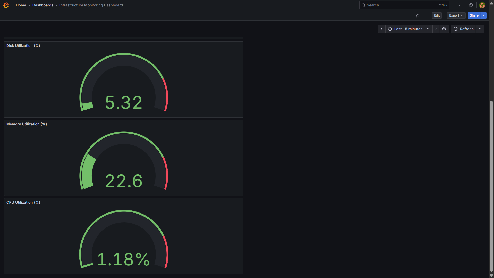
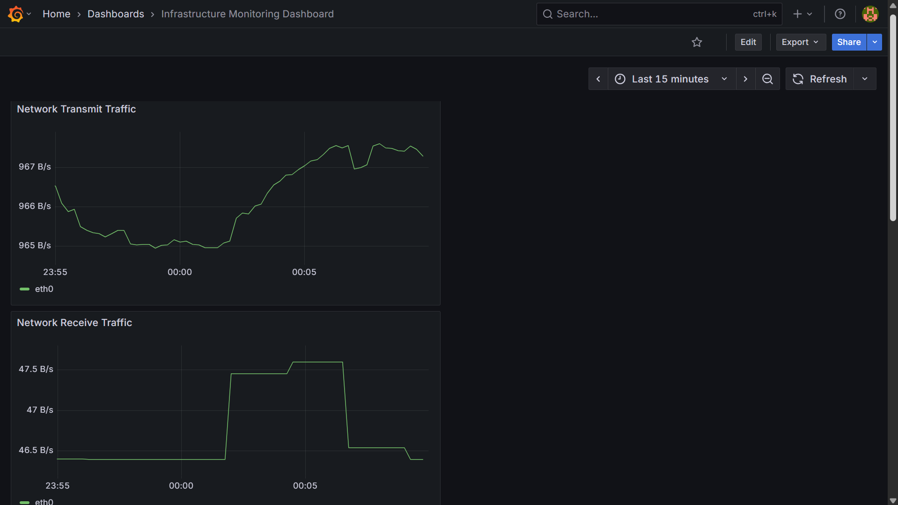

# IT Infrastructure Engineer Portfolio

A hands-on portfolio documenting practical projects in Linux system administration, networking, web server deployment, infrastructure monitoring, and troubleshooting.

## About Me

**Jahid Hasan**  
Aspiring IT Infrastructure Engineer  
Based in Japan

I have a Bachelor's degree in Electrical and Electronic Engineering and am developing practical IT infrastructure skills through hands-on projects and technical exercises.

My current focus is Linux administration, network fundamentals, server configuration, infrastructure monitoring, and troubleshooting.

## Technical Skills

| Area | Technologies and Skills |
|---|---|
| Operating Systems | Ubuntu Linux, WSL2 |
| System Administration | Linux users, groups, permissions, systemd |
| Web Servers | Nginx, server-block configuration |
| Networking | IP addressing, subnetting, DNS, routing, HTTP, ports |
| Monitoring | Prometheus, Grafana, Node Exporter, PromQL |
| Containers | Docker, Docker Compose |
| Troubleshooting | Log analysis, service inspection, connectivity diagnostics |
| Scripting | Bash fundamentals |
| Version Control | Git, GitHub |

## Completed Projects

### 1. Linux System Administration Lab

Practical exercises covering Linux users, groups, permissions, and shared-directory access.

**What I implemented:**
- Created and managed Linux users and groups.
- Configured directory ownership and permissions.
- Implemented group-based access control.
- Tested access restrictions using different user accounts.
- Configured setgid for group inheritance.

**Documentation:** `docs/linux-user-permission-management.md`

### 2. Nginx Web Server Deployment and Troubleshooting

Installed and configured Nginx on Ubuntu 24.04 running under WSL2 and deployed a custom local website.

**What I implemented:**
- Installed and managed the Nginx service.
- Created a custom HTML website.
- Configured an Nginx server block.
- Configured local hostname resolution.
- Tested HTTP responses using `curl`.
- Inspected Nginx access and error logs.
- Simulated an HTTP 404 incident by changing the document root.
- Diagnosed the cause and restored the working configuration.

**Project files:**
- `web/index.html`
- `nginx/infrastructure-lab.conf`
- `docs/nginx-deployment.md`
- `incidents/nginx-404-incident.md`

### 3. Network Engineering Lab

Performed practical network inspection and connectivity troubleshooting in Ubuntu WSL2.

**What I implemented:**
- Inspected network interfaces and IP addresses.
- Calculated IPv4 subnet details for a `/20` network.
- Examined routing tables and default gateway configuration.
- Inspected DNS resolution.
- Tested connectivity using `ping`, `curl`, and `getent`.
- Examined listening TCP and UDP sockets.
- Inspected local firewall status.
- Verified local Nginx connectivity.

**Documentation:** `docs/network-engineering-lab.md`

### 4. Infrastructure Monitoring with Prometheus and Grafana

Built a Docker Compose-based monitoring environment using Prometheus, Grafana, and Node Exporter.

**What I implemented:**
- Deployed three monitoring services using Docker Compose.
- Configured Prometheus scrape targets and a 15-second scrape interval.
- Connected Grafana to Prometheus using datasource provisioning.
- Verified Prometheus targets and service health.
- Created five Grafana dashboard panels:
  - CPU utilization
  - Memory utilization
  - Disk utilization
  - Network receive traffic
  - Network transmit traffic
- Used PromQL to query infrastructure metrics.
- Configured local environment variables for Grafana credentials.
- Excluded sensitive `.env` files from Git.

**Technology stack:** Docker, Docker Compose, Prometheus, Grafana, Node Exporter, PromQL.

**Documentation:** `docs/monitoring/infrastructure-monitoring.md`

**Dashboard screenshots:**

## Current Learning Roadmap

The following projects are planned or under development:

- **Cloud Infrastructure:** Introduction to AWS infrastructure and cloud networking.
- **IT Service Operations:** Incident management, troubleshooting workflows, and technical documentation.
- **Automation:** Bash and Python scripts for routine administration tasks.

## Tools and Technologies

Ubuntu Linux, Bash, Git, GitHub, Nginx, systemd, Docker, Docker Compose, Prometheus, Grafana, Node Exporter, curl.

Additional technologies will be added as I complete practical projects with them.

## Environment

- Operating System: Ubuntu 24.04 LTS
- Environment: Windows Subsystem for Linux 2 (WSL2)
- Container Platform: Docker Desktop
- Hardware: Intel Core i5, 16 GB RAM
- Version Control: Git

These projects are hands-on learning exercises in a local lab environment, not claims of production infrastructure experience. Node Exporter metrics in the Docker Desktop environment should not be interpreted as direct measurements of the physical Windows host.

## Author

**Jahid Hasan**

GitHub: [github.com/jhsam007](https://github.com/jhsam007)
